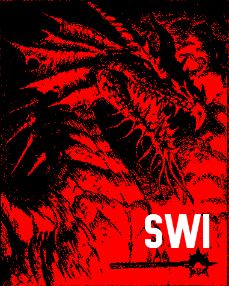

# swi 

Editor TUI vi-like, **lazy** y **scriptable** sobre el motor jotter. **musl
dinámico**, motor escrito en módulos **LLVM IR** y un driver Fexl persistente
que decide el layout, los atajos y los formateadores. En `fast` hay dos binarios
(`swi` y su hijo `fexlswi0`); en los perfiles de tamaño hay **un solo ELF**
(`swi`) que incluye al intérprete Fexl, y `fexlswi0` es un symlink a ese ELF.

Pensado para leer y editar archivos grandes de texto: importa no repintar todo
el buffer y poder scriptar el análisis desde Fexl.
Logo robado del split lp de Druadan Forest/Old Sorcery (escuchen dungeon synth)
```
swi/
├── tui/          código C/H/IR del editor (termbox2, state, win_editor, …)
├── test/         arneses por módulo
├── abi/          tui_abi.h y fexl_abi.h (fronteras C ↔ IR)
├── core/ regex/ fsio/   módulos IR del motor
├── fexl/         núcleo Fexl en IR (value_types, memory, value, str, parse,
│                 type_num, type_cmp, basic, type_str, type_sym, type_output,
│                 type_record, buf, buf_str, file, file_str, convert,
│                 type_rand, type_limit, type_math)
├── fexlswi/      intérprete Fexl (C restante) + binarios (fexlswi / fexlswi0)
├── regex/        11 módulos IR de regex compartidos con fexlswi
├── ui.fxl        driver Fexl (layout, bindings, STATUS/LOG)
├── build*/       binarios generados
└── docs: BUILD.md · about.md · cheatsheet.md · extend.md · scripting.md · addformat.md · spec.md
```

## Arrancar

```bash
make opt          # UN binario: swi + intérprete Fexl fusionados (LTO, -Oz)
make opt-full     # opt + segunda ronda de Oz + flags de link agresivos
make selfh        # como opt pero sin globaldce en el fusionado
make fast         # swi -O0 -g; fexlswi aparte (proceso hijo, como antes)
make clean all    # limpia fexlswi y swi, sin compilar
make install      # empaqueta build/ con un binario y una carpeta
./build/swi archivo.txt
```

`make install` funciona después de `opt` u `opt-full`. `build/` queda con
un solo binario (`swi`), el symlink `fexlswi/bin/fexlswi0 -> ../../swi` y una
sola carpeta (`fexlswi/`, con las librerías Fexl en `src/lib`).

`make opt`, `opt-full` y `selfh` compilan **todo junto**: `fexlswi` genera
`fexlswi_lib.bc` (sin internalizar, con `main -> fexl_main`) y `swi` lo linkea
consigo en `fused.bc`; un `dispatch.c` generado elige `fexl_main` o `swi_main`
según `argv[0]`. `fast` mantiene dos ELF separados. No hace falta un paso previo
separado. Si querés reconstruir solo el intérprete,
`make -C fexlswi clean all` sigue funcionando.

## Diseño

- **Vi-like**: NORMAL / INSERT / VISUAL / COMMAND, `h/j/k/l`, `dd/yy/p/u`,
  búsqueda `/pat` y `n/N`, selección visual.
- **Lazy**: el viewport pinta solo las filas visibles, y `doc_load()` mapea el
  archivo con `mmap` y crea chunks **zero-copy**. Las ediciones son COW por
  chunk y `:w` escribe chunk por chunk: nada se materializa completo. Quedan
  deudas aceptadas (`find_in_doc` y `doc_replace_all` sí materializan, y
  `doc_reindex()` es O(n)). Ver `spec.md` y `core/document.ll`.
- **LLVM + musl**: motor en módulos `.ll`, perfiles `fast`, `opt`, `opt-full` y
  `selfh`, link dinámico contra musl (`-L/usr/lib/x86_64-linux-musl`,
  `--dynamic-linker`, `-rpath`). Ver `BUILD.md`.
- **Scriptable**: `ui.fxl` controla `CONSOLE_H`, `TABS_COL`, `FILEMAN_W`,
  `STATUS`, `LOG`, `BIND` y los spans `SPANS`; las definiciones de la consola
  persisten en un script de sesión por PID.
- **Colores**: el driver calcula spans con `regex.spans` y el editor mapea
  `style_id` a la paleta: 1 búsqueda/amarillo, 2 keyword/cian, 3 string/verde,
  4 comment/gris, 5 number/magenta. Ver `addformat.md`.
- **Scripting**: `ui.fxl` decide layout y atajos; la consola Fexl evalúa
  expresiones con `regex.compile` / `regex.spans` / `abregex.*`. Ver
  `scripting.md`.
- **Bioinformática**: el editor maneja texto plano; los visores de FASTQ,
  BCF/BAM y `rec/` quedan fuera del alcance actual (ver `spec.md`, §10).

## Qué hay dentro

- **NORMAL / INSERT / VISUAL / COMMAND**, `h/j/k/l`, mots de palabra,
  `dd/yy/p/u`, búsqueda `/pat` y `n/N`, selección visual.
- **Consola** `Ctrl+E`: evalúa Fexl y guarda las definiciones de la sesión.
- **File manager** `Ctrl+F`: `j/k`, `Enter`, `h`/`Backspace`, `t` para abrir
  en tab nueva; la entrada `..` sube de directorio.
- **Tabs** `Ctrl+T` nueva, `Ctrl+W` cerrar, `Ctrl+N` siguiente, `Ctrl+B`
  colapsar.
- **Barra de estado** con modo, posición, dirty flag y estado de Fexl.
- Sesión persistente (tabs, cursor, foco, layout, directorio).

## Documentos

| Archivo | Contenido |
|---|---|
| `BUILD.md` | compilación, toolchain, perfiles y rutas |
| `about.md` | arquitectura y decisiones de diseño |
| `cheatsheet.md` | teclas, comandos y resolución de problemas |
| `extend.md` | cómo extender la UI (paneles, teclas, builtins) |
| `scripting.md` | Fexl, protocolo, fexlswi y la API regex |
| `addformat.md` | cómo agregar formateadores de sintaxis desde Fexl |
| `spec.md` | especificación original del proyecto (histórica) |

## Tests

```bash
make test                  # 183 checks, perfil fast
make test-opt
make MODE=opt-full test
make test-selfh
```
